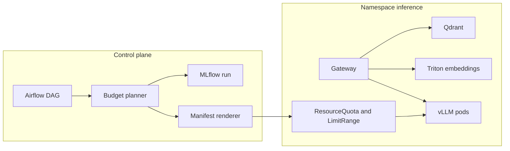

# mlops-vllm-k8s-cluster

A high-throughput, low-latency model inference platform. Automates multi-node GPU slicing and open-source LLM deployments inside a local Kubernetes cluster under strict compute budgets.

The lab in [`configs/cluster.yaml`](configs/cluster.yaml) has four A100-40GB GPUs and only releases **two of them and 80 GiB**. A deployment that does not fit is rejected before a pod is created. Accepted plans become vLLM manifests: MIG slices when one replica fits in a slice, tensor parallel when it fits on one node, pipeline parallel when the GPUs are split across nodes.

**Stack:** Kubernetes, vLLM, Triton Inference Server, MLflow, Airflow, PyTorch, Qdrant.

Paste this into the GitHub About description:

> A high-throughput, low-latency model inference platform. Automates multi-node GPU slicing and open-source LLM deployments inside a local Kubernetes cluster under strict compute budgets.

Topics: `kubernetes` `mlops` `vllm` `triton-inference-server` `mlflow` `airflow` `pytorch` `qdrant`

## Architecture



Triton serves the embedding model with dynamic batching. vLLM serves generative decoding. The gateway retrieves runbook chunks from Qdrant, calls vLLM, and drops the answer unless every `[doc_id]` was in the retrieved set.

With `VLLM_BASE_URL` unset, the gateway quotes the retrieved runbooks itself so the control plane runs on a CPU laptop. That path is a stand-in, not a model.

## What the planner does

Weights are `params × bytes per parameter`, plus a 1.15 overhead for scales and the CUDA context. The KV cache is reserved for the full `max_model_len × max_num_seqs`, and it stays fp16 when the weights are AWQ, GPTQ, or int8. vLLM shards that total across `tensor_parallel × pipeline_parallel`.

MIG profile memory is the nvidia-smi capacity on A100-SXM4-40GB, not the rounded name (`2g.10gb` is 9.62 GiB, and 90% of that is the usable budget). A slice is used only when the whole replica fits in it. Time-slicing is last: it does not isolate VRAM, so each pod gets `gpu-memory-utilization / replicas_per_gpu` and the plan still reserves the entire device.

When several placements fit, the planner keeps the one that uses fewer physical GPUs, then less reserved VRAM, then MIG over a dedicated device over time-slicing, then more SMs, then less parallelism.

| Model | Quant | Replicas | Placement under the 2× GPU / 80 GiB budget | Reserved |
| --- | --- | --- | --- | --- |
| Qwen2.5-7B | AWQ | 2 | MIG `2g.10gb` on 1 GPU. `1g.10gb` has the same 9.62 GiB but half the SMs | 19.2 GiB |
| Qwen2.5-7B | fp16 | 1 | Full A100-40GB. 19.8 GiB does not fit a 20GB slice | 40 GiB |
| Llama-3.1-8B | AWQ | 1 | MIG `4g.20gb`. Same memory as `3g.20gb`, more SMs | 19.5 GiB |
| Llama-3.1-8B | AWQ | 2 | MIG `3g.20gb`. One GPU holds two slices; `4g.20gb` would take two GPUs | 39 GiB |
| Llama-3.1-70B | AWQ | 1 | Tensor parallel 2 on node-a. The other node stays dark | 80 GiB |
| Llama-3.1-70B | fp16 | 1 | Rejected. Hint: AWQ fits on 2 GPUs | — |
| Llama-3.1-70B | AWQ | 1, one GPU per node | Pipeline parallel 2, with pod anti-affinity across nodes | 80 GiB |

`Qwen/Qwen2.5-7B-Instruct-AWQ` is the one quantized repo id pinned in the catalog. Other AWQ plans keep the base Hugging Face id and say so on the manifest. Point `--model` at the checkpoint you actually host before apply.

Lowering `--max-num-seqs` is a budget lever: the KV term is what pushes the 8B fp16 model past a 24GB card (25.2 GiB reserved at the catalog concurrency; the AWQ checkpoint fits).

## Run it

Python 3.10 or newer.

```bash
python -m pip install -e ".[dev]"
python -m pytest
python -m mlops_cluster.cli plan --model qwen2.5-7b-instruct --quant awq --replicas 2
```

Gateway, Qdrant, and MLflow, still without a GPU:

```bash
docker compose up --build
./scripts/smoke.sh
```

Register a plan and write manifests. This does not call kubectl.

```bash
python -m mlops_cluster.cli deploy \
  --model qwen2.5-7b-instruct --quant awq --replicas 2 \
  --tracking-uri http://127.0.0.1:5000
```

The same function is the body of [`dags/deploy_llm_dag.py`](dags/deploy_llm_dag.py). Install the package on the Airflow worker and point a DagBag at `dags/`.

Apply the platform, then a rendered model, on a cluster that already has the NVIDIA GPU Operator. MIG on this lab is the mixed strategy (`nvidia.com/mig-2g.10gb` and the other profile resources).

```bash
docker build -t mlops-gateway:local .
kubectl apply -k k8s/base
kubectl apply -k k8s/examples/qwen2.5-7b-awq
```

`scripts/kind-up.sh` loads the gateway image into a kind cluster and applies `k8s/base`. Kind will not schedule the GPU pods.

`docker compose --profile gpu up` starts `vllm/vllm-openai:v0.32.0` on TinyLlama. Set `VLLM_BASE_URL=http://vllm:8000` on the gateway when you want generation to leave the local quoter.

Triton is a separate image so the gateway stays small:

```bash
docker build -f Dockerfile.triton -t mlops-triton:local .
```

The Python backend in `triton/model_repository/bge_embed` loads the PyTorch hash encoder. Replace that module with a sentence-transformers projection; the Triton contract stays `TEXT` in, a 384-d vector out. Install the optional extra with `pip install -e ".[torch]"` to exercise the same module locally.

## Layout

| Path | Role |
| --- | --- |
| `src/mlops_cluster/planner.py` | MIG, dedicated, and time-slice placement |
| `src/mlops_cluster/memory.py` | Weight and KV estimate |
| `src/mlops_cluster/render.py` | Deployment or StatefulSet plus Service |
| `src/mlops_cluster/gateway.py` | Retrieval, vLLM, citation check |
| `src/mlops_cluster/registry.py` | File run plus the MLflow REST API |
| `configs/` | Lab budget and model geometry |
| `k8s/base/` | Namespace, quota, limits, network policy, Qdrant, MLflow, Triton, gateway |
| `k8s/examples/` | Rendered plans checked against the planner in tests |
| `dags/deploy_llm_dag.py` | Airflow wrapper around `deploy_model` |

## Decisions that the tests lock in

- A 7B AWQ replica at 16 sequences and 4096 tokens is about 7.6 GiB. That misses `1g.5gb` (4.75 GiB, 90% usable) and fits `2g.10gb`. `1g.10gb` is the same memory and fewer SMs, so it loses the tie.
- Time-slicing four TinyLlama replicas onto one RTX 4090 sets `--gpu-memory-utilization 0.225` and writes a device-plugin ConfigMap with `replicas: 4`. The physical reservation is still the whole 24 GiB.
- Pipeline parallel is rendered only for a single replica group. The client Service selects `statefulset.kubernetes.io/pod-name: <name>-0` (Kubernetes 1.28+). Stages get a headless Service and required hostname anti-affinity.
- The namespace quota caps `requests.nvidia.com/gpu` at 2 and caps each MIG resource at what two A100-40GB devices can host. The planner is the gate; the quota is the backstop.
- LLM ingress is only from gateway pods. Egress allows in-namespace traffic, DNS, and 80/443 so a pod can pull weights.
- Answers with no citation, or a citation outside the retrieved ids, are replaced with the guardrail reason. The invented text is not returned.

## Limits

This is a local reference platform. CI plans and renders; it does not boot a GPU, NCCL, or Triton. The memory math is a capacity plan, not a CUDA profiler trace. A100-80GB profile sizes in the SKU table are the 40GB nvidia-smi figures scaled by two. Multi-node process-group startup is left to the vLLM image. The hash encoder is deterministic and shared by the gateway and Triton; it is not a semantic embedding model.
